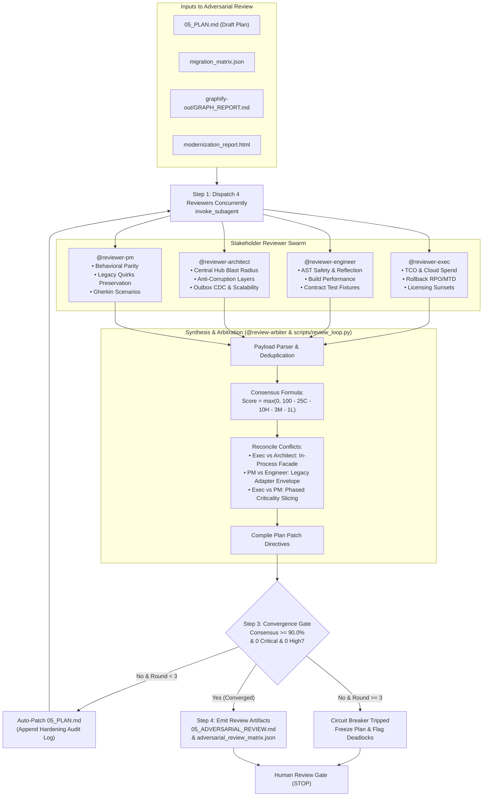

# Skill: Adversarial Review & Plan Hardening Loop

Orchestrate a multi-persona adversarial review on an OKF-compatible modernization implementation plan (`05_PLAN.md`). Reconcile conflicting stakeholder incentives, resolve architectural trade-offs, and iteratively patch the plan until consensus criteria are met.



---

## Operational Protocol

### Prerequisites & Required Inputs
Before initiating the review loop, confirm the presence of:
1. `05_PLAN.md` (The drafted OKF-compatible modernization plan to be audited).
2. `migration_matrix.json` (Discovered component inventory and 7 Rs mappings).
3. `graphify-out/GRAPH_REPORT.md` (Topological dependencies and Central Dependency Hubs).

---

### Step 1: Dispatch Adversarial Reviewer Swarm
Dispatch all four specialized stakeholder reviewers in parallel using `invoke_subagent`:
- `reviewer-exec` (`Model: "inherit"`): Audit `05_PLAN.md` against `migration_matrix.json` for TCO, cloud run-rate, licensing sunsets, and RPO/MTD using `read_file`.
- `reviewer-engineer` (`Model: "inherit"`): Audit `05_PLAN.md` for AST transformation safety, reflection risks, build performance, and contract test fixtures using `read_file`.
- `reviewer-architect` (`Model: "inherit"`): Audit `05_PLAN.md` against `graphify-out/GRAPH_REPORT.md` for Central Dependency Hub isolation, ACLs, Outbox + CDC, and zero-trust boundaries using `read_file`.
- `reviewer-pm` (`Model: "inherit"`): Audit `05_PLAN.md` for 1:1 behavioral parity, legacy quirks preservation, and Gherkin acceptance criteria using `read_file`.

#### Execution Gate:
- **Do not poll or loop.**
- Stop calling tools and allow the Antigravity reactive messaging system to resume execution when all four subagents post completion notifications.

---

### Step 2: Ingest Findings & Synthesize Scorecard
Once all four subagent review payloads are received, execute the arbitration engine (or `@review-arbiter` from `bean-core`) to deduplicate findings, calculate consensus scores, and synthesize directives:

1. Call `run_command`:
   ```bash
   python3 scripts/review_loop.py --plan-dir assessments/runs/latest/
   ```
2. The script computes the consensus score using:
   $$\text{Score} = \max(0, 100 - (25C + 10H + 3M + 1L))$$
   where $C = \text{Critical}$, $H = \text{High}$, $M = \text{Medium}$, and $L = \text{Low}$ severity findings.

---

### Step 3: Convergence Evaluation Gate
Evaluate the round scorecard:
- **Success Criteria**: Consensus Score $\ge 90.0\%$ with **0 Critical** and **0 High** flaws remaining.
  - **Verdict**: Mark plan as `CONVERGED_ROBUST`. Proceed to Step 4.
- **Revision Required** (Score $< 90.0\%$ or unresolved Critical/High issues, and $\text{Round} < 3$):
  - Append the arbiter's patch directives to `05_PLAN.md` using `edit_file`.
  - Repeat from Step 1 for the next review round.
- **Circuit Breaker** (Score $< 90.0\%$ and $\text{Round} \ge 3$):
  - Mark verdict as `CIRCUIT_BREAKER_TRIGGERED`.
  - Halt automated iterations. Document the deadlocked trade-offs for human arbitration. Proceed to Step 4.

---

### Step 4: Emit Artifacts & Report
1. **Verify Output Artifacts**:
   - `assessments/runs/latest/03_adversarial_review/adversarial_audit_report.md` (and `05_ADVERSARIAL_REVIEW.md`)
   - `assessments/runs/latest/03_adversarial_review/adversarial_review_matrix.json`
   - `assessments/runs/latest/04_migration_plan/05_PLAN.md` (updated with Hardening Audit Log)
2. **Present Summary to User**:
   - Report the final consensus score, round count, and verdict (`CONVERGED_ROBUST` or `CIRCUIT_BREAKER_TRIGGERED`).
   - If converged: Present approved `05_PLAN.md` link and invite the user to approve execution.
   - If deadlocked: Detail the trade-off conflict between personas and request human decision.
