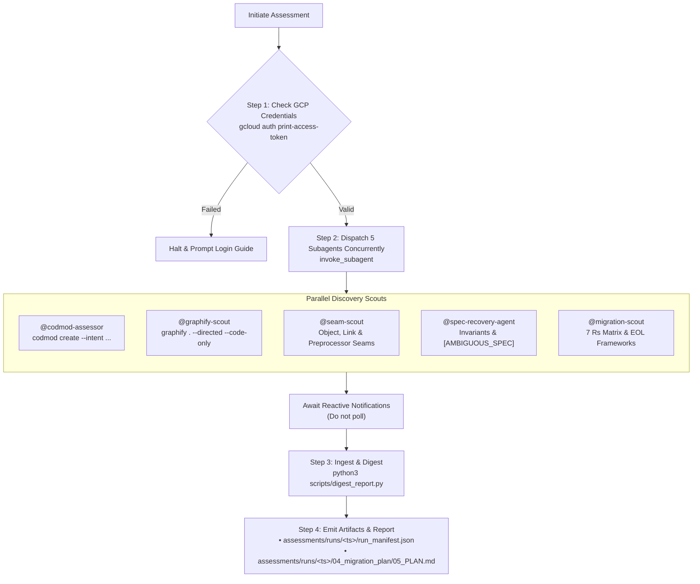

# Skill: Application Modernization Assessment

Orchestrate a comprehensive, non-destructive codebase discovery and modernization assessment across semantic, architectural, and procedural dimensions.



---

## Operational Protocol

### Step 1: Pre-Flight Credential Verification
Verify active Google Cloud authorization before launching remote assessment operations.

1. Call `run_command` to inspect active GCP configuration:
   ```bash
   gcloud config get-value project
   gcloud auth print-access-token
   ```
2. **Evaluation**:
   - If both commands return exit code `0` and a non-empty token: Proceed to Step 2.
   - If either command fails or exits non-zero:
     - Output an error instructing the user to authenticate via `gcloud auth application-default login` or set `GOOGLE_APPLICATION_CREDENTIALS`.
     - Halt execution immediately. Do not proceed to subagent dispatch.

---

### Step 2: Concurrent Subagent Dispatch
Dispatch all five specialized discovery scouts simultaneously using `invoke_subagent`.

#### Antigravity Subagent Execution Rules:
- Use specific subagent `TypeName`s (`codmod-assessor`, `graphify-scout`, `seam-scout`, `spec-recovery-agent`, `migration-scout`) so `/agents` in the TUI displays meaningful names instead of generic 'self' or 'research'.
- Set `Model: "inherit"` on all subagents to preserve the parent session's configured model tier.
- **Isolation Rule (No `/teamwork` in Stage 1 Discovery)**: Stage 1 Discovery Scouts (`@codmod-assessor`, `@graphify-scout`, `@seam-scout`, `@spec-recovery-agent`, `@migration-scout`) must remain isolated `invoke_subagent` calls (never `/teamwork`) so discovery remains unbiased and free from cross-scout groupthink.

#### Dispatch Payload:
Call `invoke_subagent` for each of the 5 scouts:
- `codmod-assessor`: Execute Google Cloud `codmod create` modernization assessment on `{{target_dir}}`, stage report to `01_discovery/codmod_assessment_report.html` using `write_file`, and return a structured summary.
- `graphify-scout`: Execute `graphify . --directed --code-only && graphify cluster-only .`, stage `01_discovery/graphify_architecture_report.md` using `write_file`, and return graph metrics and central dependency hubs.
- `seam-scout`: Conduct non-destructive structural seam exploration, write `01_discovery/seam_findings.md` using `write_file`, and return a Markdown table of seams.
- `spec-recovery-agent`: Reconstruct business rules and state machines, flag `[AMBIGUOUS_SPEC: <description>]`, and write `01_discovery/spec_invariants.md` using `write_file`.
- `migration-scout`: Classify major subsystems across the 7 Rs taxonomy and write `01_discovery/migration_strategy.md` using `write_file`.

#### Execution Gate:
- **Do not poll or loop.**
- Stop calling tools and allow the Antigravity reactive messaging system to resume execution when subagents post completion messages.

---

### Step 3: Ingestion & Synthesis

1. **Verify Deliverables**:
   Confirm receipt of completion messages from all 5 subagents and verify outputs under `01_discovery/`:
   - `01_discovery/codmod_assessment_report.html` (or `modernization_report.html`)
   - `01_discovery/graphify_architecture_report.md` (or `graphify-out/graph.json`)
   - `01_discovery/seam_findings.md`
   - `01_discovery/spec_invariants.md`
   - `01_discovery/migration_strategy.md`
   - *Note:* If any subagent returned its output table in its message without writing the file, write it directly to `01_discovery/<filename>` with `write_file`.

2. **Execute Synthesis Pipeline**:
   Call `run_command` to execute `scripts/digest_report.py`, targeting a timestamped run directory:
   ```bash
   python3 scripts/digest_report.py \
     --report modernization_report.html \
     --graph graphify-out/graph.json \
     --seams-report 01_discovery/seam_findings.md \
     --specs-report 01_discovery/spec_invariants.md \
     --migration-report 01_discovery/migration_strategy.md \
     --output-dir assessments/runs/latest
   ```

3. **Verify Generated Artifacts**:
   Ensure the following output hierarchy is created:
   - `assessments/runs/<timestamp>/run_manifest.json` (Structured scorecard metadata)
   - `assessments/runs/<timestamp>/01_discovery/` (Discovery reports and telemetry)
   - `assessments/runs/<timestamp>/02_synthesis/` (`migration_matrix.json`, `vertical_slices.json`)
   - `assessments/runs/<timestamp>/04_migration_plan/05_PLAN.md` (OKF-compatible initial migration plan)

---

### Step 4: Presentation & Next Phase Hand-Off

1. **Present Summary to User**:
   Provide a concise executive overview containing:
   - **Codebase Scale**: Lines of Code, file count, primary languages.
   - **Modernization Assessment**: Top 3 critical modernization blockers identified by CodMod.
   - **Topological Bottlenecks**: Top 3 high-blast-radius dependency hubs identified by Graphify.
   - **Strategic Posture**: 7 Rs breakdown summary (Refactor vs Replatform vs Retain).
   - **Discovered Seams & Ambiguous Rules**: Total seam intervention points and count of `[AMBIGUOUS_SPEC]` items requiring domain review.

2. **Recommend Next Action**:
   Prompt the user to review the generated plan, adjust synthesis if desired, or initiate adversarial hardening:
   > "Assessment complete. Review `assessments/runs/latest/04_migration_plan/05_PLAN.md`. You can re-run synthesis with `/synthesize` (or dispatch `@synthesis-agent` to tailor slices and clarify invariants), or run `/adversarial-review` to stress-test the migration architecture."
