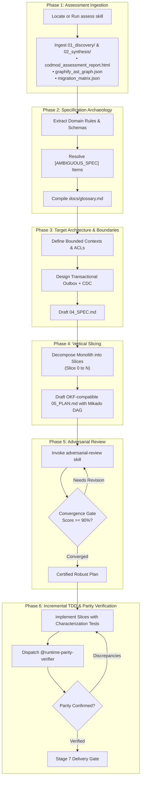

# Skill: Application Rewrite Orchestrator

Orchestrate the end-to-end modernization of legacy codebases into cloud-native architectures. Ensure zero behavioral regressions, decouple monolithic hubs via Anti-Corruption Layers, and verify runtime parity.

---

## Operational Protocol

### Phase 1: Ingest Assessment Deliverables
1. **Verify Assessment Artifacts**:
   - Check if an assessment run exists under `assessments/runs/latest/`.
   - If no assessment run is found, instruct the user to run the `assess` skill first, or invoke it to generate discovery artifacts.
2. **Extract Key Constraints**:
   - Identify legacy source stack, language version, and build system.
   - Inspect Central Dependency Hubs from `01_discovery/graphify_architecture_report.md` to identify coupling bottlenecks.
   - Extract the 7 Rs classification from `02_synthesis/migration_matrix.json` (Retire vs Replatform vs Refactor).
   - Target modern cloud compute (Cloud Run, GKE) and managed database engines (Cloud SQL, Spanner).

---

### Phase 2: Specification Archaeology & Ubiquitous Language
To keep the main orchestrator in the **Smart Zone (< 100K tokens)**, never inspect legacy controllers or reconstruct schemas inline. Delegate archaeology to subagents:
1. **Extract Domain Rules & Invariants**:
   - Dispatch `@spec-recovery-agent` via `invoke_subagent` (`Model: "inherit"`) to inspect legacy controllers, entity models, and business services and emit `01_discovery/spec_invariants.md`.
2. **Compile Domain Glossary**:
   - Have `@spec-recovery-agent` synthesize domain definitions, business rules, and API contracts into `docs/glossary.md`, flagging any implicit or contradictory behaviors as `[AMBIGUOUS_SPEC: <description>]`. Clarify `[AMBIGUOUS_SPEC]` items with the user before proceeding.

---

### Phase 3: Target Domain Architecture & Structural Decoupling
Delegate structural seam analysis and specification authoring to keep the orchestrator in the **Smart Zone**:
1. **Define Bounded Contexts & Anti-Corruption Layers (ACLs)**:
   - Dispatch `@seam-scout` via `invoke_subagent` (`Model: "inherit"`) to identify Object, Link, and Preprocessor seams around legacy Central Dependency Hubs and design Anti-Corruption Layers (ACLs).
2. **Data Consistency Strategy**:
   - Do not use distributed 2PC transactions or application-level dual writes.
   - Employ the **Transactional Outbox Pattern** combined with Change Data Capture (CDC) or event messaging.
3. **Compile Technical Specification**:
   - Dispatch `@synthesis-agent` via `invoke_subagent` (`Model: "inherit"`) to document target APIs, entity definitions, IAM roles, and cloud resource requirements in `04_SPEC.md`.

---

### Phase 4: Vertical Slicing & Execution Planning
1. **Mikado Slicing Strategy**:
   - Break down the rewrite into vertical, independently verifiable slices:
     - **Slice 0 (Foundation):** Target project scaffolding, CI/CD, database schemas, and baseline health checks.
     - **Slice 1 (Read-Only Path):** Legacy read API replication and contract characterization tests.
     - **Slice 2 (State Mutation & Outbox):** Write paths, transactional outbox events, and validation logic.
     - **Slice 3 (Integration & Cutover):** Edge routing, Strangler Fig proxying, and reverse-sync.
2. **Compile OKF-Compatible `05_PLAN.md`**:
   - Run the `/synthesize` skill or dispatch `@synthesis-agent` via `invoke_subagent` (`Model: "inherit"`) to generate and iterate on dependency-ordered vertical slices (tagged with `[Serial]` or `[Parallel]`), acceptance criteria, file targets, and rollback procedures in an OKF-compatible `05_PLAN.md`.

---

### Phase 5: Adversarial Review Loop
1. **Invoke Review Skill**:
   - Call the `adversarial-review` skill to audit `05_PLAN.md` against Executive, Engineering, Architectural, and Product criteria.
   - **When to Recommend `/teamwork`**: For complex legacy rewrites and high-blast-radius Carafe modernizations with conflicting stakeholder trade-offs, recommend running `adversarial-review` in **Mode B: Antigravity Enterprise `/teamwork` Autonomous Stakeholder Council** (`@synthesis-agent`, `@reviewer-exec`, `@reviewer-architect`, `@reviewer-pm`, `@reviewer-engineer`, and `@review-arbiter` debating directly via `send_message`).
2. **Iterate to Convergence**:
   - Review and incorporate directives from `@review-arbiter` (from `bean-core`) until the consensus score reaches $\ge 90\%$ with 0 Critical and 0 High defects.
   - Present the hardened plan to the user for formal approval before modifying code.

---

### Phase 6: Incremental Implementation & Runtime Parity Verification
Never edit application source code inline from the main orchestrator. Delegate slice execution and parity verification to subagents:
1. **Implement Slices via Subagent Delegation**:
   - Dispatch `@ast-grinder` (and `@msbuild` for .NET workloads) via `invoke_subagent` (`Model: "inherit"`) to write characterization test fixtures, execute AST-safe code transformations, and run sandboxed builds/tests.
2. **Dynamic Parity Verification**:
   - For each completed vertical slice, dispatch `@runtime-parity-verifier` via `invoke_subagent` (`Model: "inherit"`) to replay test vectors against both the legacy endpoint and the modernized candidate.
   - **Parallel Slice Implementation with `/teamwork`**: When executing complex or parallel `[Parallel]` vertical slices, recommend Antigravity Enterprise `/teamwork` pairing `@ast-grinder` + `@runtime-parity-verifier` so `@ast-grinder` and `@runtime-parity-verifier` coordinate live via `send_message` to resolve parity discrepancies iteratively.
   - Require `APPROVED: RUNTIME_PARITY_VERIFIED` in `docs/parity_discrepancies.md` before concluding the slice.

---

### Phase 7: Delivery & Final Hand-Off
1. **Emit Modernization Manifest**:
   - Update `assessments/runs/latest/run_manifest.json` with final implementation status, test metrics, and parity diffs.
2. **Present Walkthrough**:
   - Provide the user with a summary of delivered slices, verified parity results, and links to the code changes.
