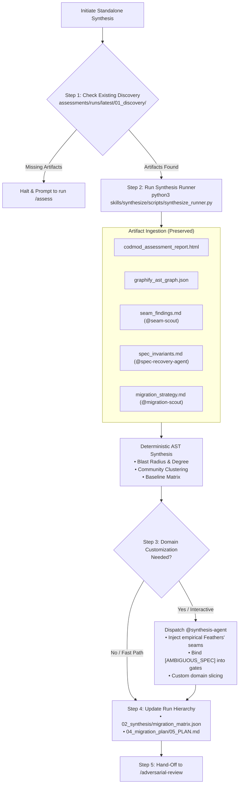

# Skill: Standalone Architectural Synthesis & Slicing

Execute or re-run architectural synthesis on existing assessment discovery artifacts without re-dispatching heavy discovery scouts (`codmod`, `graphify`, etc.). Reconcile multi-scout findings, tailor vertical slices to domain boundaries, and compile an actionable OKF-compatible `05_PLAN.md` and `migration_matrix.json`.



---

## Operational Protocol

### Step 1: Target Run Resolution & Discovery Verification
1. Resolve the target assessment run directory:
   - Default: `assessments/runs/latest/` (or most recent run in `assessments/runs/`).
   - Custom: A specific directory or timestamp specified by the user (e.g., `assessments/runs/20260909_120000`).
2. Verify that `01_discovery/` contains the necessary baseline reports using `read_file`:
   - `codmod_assessment_report.html` (or `modernization_report.html`)
   - `graphify_ast_graph.json` (or `graph.json`)
3. If discovery artifacts are missing:
   - Inform the user: *"No previous assessment discovery artifacts found. Please execute `/assess` first to run discovery scouts."*
   - Halt execution cleanly.

---

### Step 2: Execute Standalone Synthesis Runner
Execute the colocated helper script:

```bash
python3 skills/synthesize/scripts/synthesize_runner.py --run-dir latest
```

#### Supported Options:
- `--run-dir <path|id>`: Target a specific historical run.
- `--summary-only`: Print scorecard to stdout without overwriting files.

The runner will:
1. Ingest `01_discovery/` reports.
2. Ingest empirical scout reports if present (`seam_findings.md`, `spec_invariants.md`, `migration_strategy.md`).
3. Compute graph degrees, community clusters, and vertical slices.
4. Emit `02_synthesis/migration_matrix.json`, `02_synthesis/vertical_slices.json`, and an OKF-compatible `04_migration_plan/05_PLAN.md`.
5. Update `run_manifest.json`.

---

### Step 3: Domain Customization with `@synthesis-agent` (Optional / On Demand)
If the user specifies custom domain requirements, requests non-standard slicing, or provides domain answers for ambiguous specifications:

1. Dispatch `@synthesis-agent` via `invoke_subagent` with `Model: "inherit"` to update `04_migration_plan/05_PLAN.md` and `02_synthesis/migration_matrix.json` using `read_file`, `edit_file`, and `write_file`.
2. Await completion notification.

---

### Step 4: Presentation & Next Action
Present a summary of the synthesized plan to the user:
- Total component modules & central dependency hubs.
- Ordered vertical migration slices.
- Paths to `04_migration_plan/05_PLAN.md` and `02_synthesis/migration_matrix.json`.
- Recommend next step:
  > *"Synthesis complete. Review `04_migration_plan/05_PLAN.md` and run `/adversarial-review` to stress-test the plan."*
